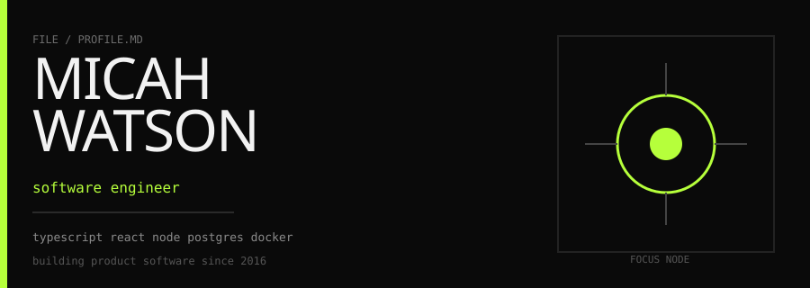

  

  

---

### hey

I'm **Micah**. I build product software end-to-end — the screens people touch, the APIs underneath, and the release path that keeps both honest.

Not interested in demo-ware. Interested in systems that survive real users, messy data, and Monday mornings.

  

### day to day

| I spend time on | I avoid |
| :--- | :--- |
| TypeScript / React product surfaces | architecture astronaut slides |
| Node services with boring reliability | rewriting for sport |
| Postgres, Docker, clean deploy paths | tool roulette every sprint |
| readable diffs and sharp reviews | clever code nobody can own |

### stack I actually use

`TypeScript` · `React` · `Next.js` · `Node` · `PostgreSQL` · `Docker` · `AWS` · `Git`

### find me

  
  

---

no third-party stats widgets · media is hosted in this repo so it stays up
