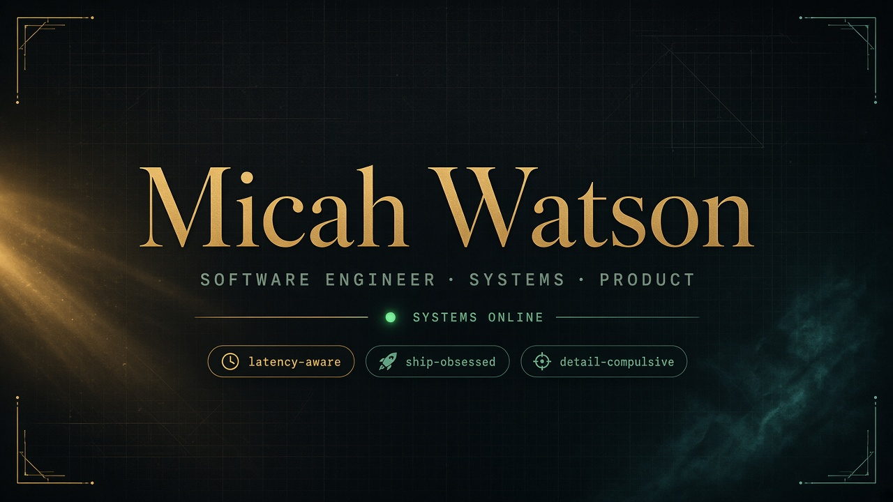
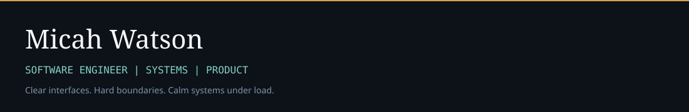

<!-- Micah Watson — profile README -->
<!-- media: use absolute raw URLs so GitHub Camo can fetch images -->

<p align="center">
  
</p>

<p align="center">
  <a href="https://github.com/micah-watson302">
    
  </a>
</p>

<p align="center">
  
  
  
  
</p>

<p align="center">
  
</p>

## ⚡ About

<table>
<tr>
<td width="68%">

### I ship software that feels inevitable.

Clear interfaces. Hard boundaries. Systems that stay calm under load.

I care about the last 5% — naming, latency, reviewability, and the kind of craft that still looks intentional six months later.

```bash
$ whoami
micah-watson302

$ cat ./mission.txt
product engineering · frontend systems · API design
less ceremony · more leverage · measurable outcomes
```

</td>
<td width="32%" valign="top">



**Now**
- Product systems
- Frontend architecture
- Cloud-native delivery

**Always**
- Clear contracts
- Fast feedback loops
- Tasteful defaults

</td>
</tr>
</table>

<p align="center">
  
</p>

## 🛠 Toolkit

<p align="center">
  
</p>

<p align="center">
  
  
  
  
  
</p>

<p align="center">
  
</p>

## 📡 Live telemetry

<!-- these cards auto-refresh from public stats APIs -->

<p align="center">
  
  
</p>

<p align="center">
  
</p>

<p align="center">
  
</p>

<p align="center">
  
</p>

<p align="center">
  
</p>

## 🧭 Operating system

```text
┌──────────────────────┬────────────────────────────────────────────┐
│ Clarity > cleverness │ Name things so nobody has to ask twice     │
│ Interfaces first     │ Contracts before implementations           │
│ Measure what matters │ Ship with observability, not folklore      │
│ Small diffs          │ Prefer reversible, reviewable change       │
└──────────────────────┴────────────────────────────────────────────┘
```

<p align="center">
  
</p>

## ✉️ Contact

<p align="center">
  <a href="mailto:micahwatson302@gmail.com"></a>
  <a href="https://github.com/micah-watson302"></a>
</p>

<p align="center">
  <b><code>craft × systems × taste</code></b><br/>
  <sub>built to make people stop scrolling</sub>
</p>
