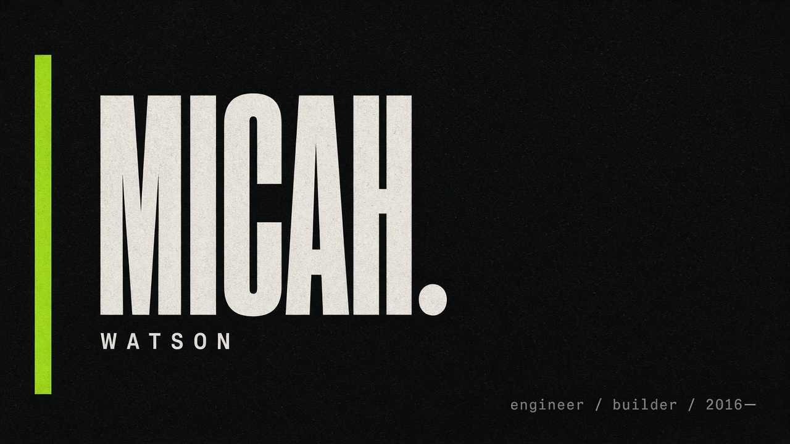
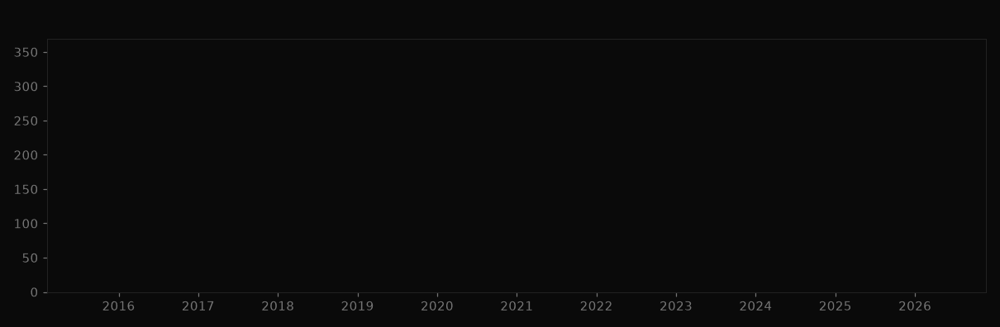
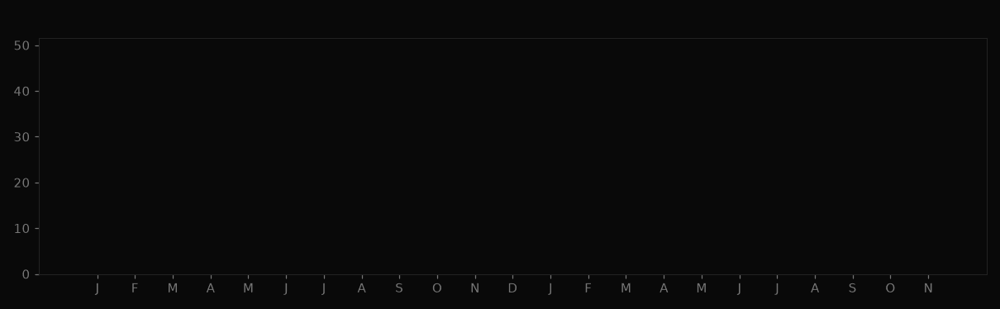
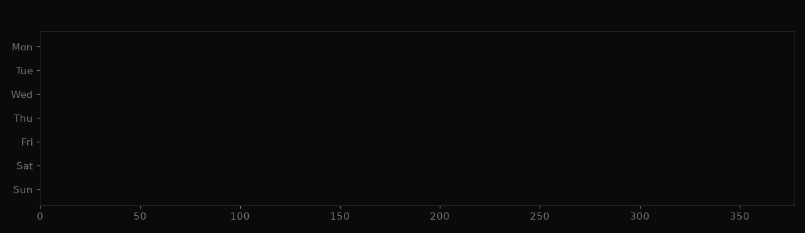

  

---

### hey

I'm **Micah**. I build product software end-to-end — the screens people touch, the APIs underneath, and the release path that keeps both honest.

Not interested in demo-ware. Interested in systems that survive real users, messy data, and Monday mornings.

### charts

  

  
  

  

  
    <b>Yearly output</b> — how commit volume grew from early years to now.
    Steady climb, not a flat line: more ownership, more shipping.
  

 

  

  
    <b>Monthly velocity</b> — last ~2 years, month by month.
    Some quiet stretches, some hard pushes. Real cadence, not fake daily noise.
  

 

  

  
    <b>Weekday pattern</b> — most work lands Mon–Fri.
    Weekends stay light on purpose.
  

### day to day

| I spend time on | I avoid |
| :--- | :--- |
| TypeScript / React product surfaces | architecture astronaut slides |
| Node services with boring reliability | rewriting for sport |
| Postgres, Docker, clean deploy paths | tool roulette every sprint |
| readable diffs and sharp reviews | clever code nobody can own |

### stack I actually use

`TypeScript` · `React` · `Next.js` · `Node` · `PostgreSQL` · `Docker` · `AWS` · `Git`

### find me

  
  

